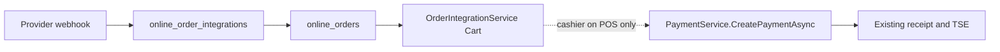

# Online Order Integrations — Design Proposal

> **Status:** Proposal only. No code, migration, package, or fiscal change ships with this document.
> **Scope:** Inbound marketplace orders (first slice: Deliverect) into the existing online-order row, then the existing POS cart bridge, then the existing payment and receipt pipeline.
> **Out of scope:** TSE signing, RKSV receipt creation, `PaymentService` edits, menu publish, FA screens, permission changes, and new dependencies.

**Last updated:** 2026-10-28

**Related:** [`ONLINE_ORDERS.md`](ONLINE_ORDERS.md) · [`DIGITAL_SERVICES.md`](DIGITAL_SERVICES.md) · [`WORKING_HOURS.md`](WORKING_HOURS.md) · [`OFFLINE_SYSTEM_INDEX.md`](OFFLINE_SYSTEM_INDEX.md)

This document does not claim RKSV, BMF, or FinanzOnline compliance. Fiscal statements below describe the current code path. Whether a marketplace sale needs a Beleg is a question for the operator and a tax advisor.

---

## As-is (do not conflate)

Customer website, PWA, and native orders are **not** fiscal. They live in `online_orders` and are fulfilled by status in FA. A receipt exists only after a cashier pays through POS.

| Surface | What it does today | What it does not do |
|---------|--------------------|---------------------|
| `POST /api/public/online-orders` → `OnlineOrderIntakeService` | Creates `online_orders` when website hours allow intake. Closed hours return `ONLINE_ORDERS_CLOSED`. | No POS cart, no TSE, no receipt. |
| `online_orders` | Tenant-scoped order, items, modifiers, status history. Unique `(tenant_id, order_number)`. Sources: `web`, `pwa`, `native`. | No external marketplace id. `tax` is stored as `0`; `total` is the gross catalog snapshot. |
| FA `/orders/online` (alias `/online-orders`, deep link `/tenant/{id}/orders`) | Inbox. List: `digital.orders.view` (route also accepts legacy `order.view`). Status: `digital.orders.manage`. | Manager UI does not push a cart or create a receipt. |
| `POST /api/admin/online-orders/{id}/accept` | `digital.orders.approve` (Super Admin). `OrderIntegrationService.PushOrderToPosAsync` creates an active `Cart` and sets `PosCartId`. A second call is a no-op when `PosCartId` is already set. | Does not call `PaymentService`. Does not sign. |
| `OnlineOrderPaymentService` + `POST /api/webhooks/stripe` | Gateway PaymentIntent for website checkout. Missing webhook secret returns HTTP 400. | Does not call `PaymentService`. A paid online order is not a Beleg. |
| `POST /api/pos/payment` → `PaymentService.CreatePaymentAsync` | The only receipt and TSE path. Requires the existing cashier, open cash-register session, and an existing payment method. | Not called by online-order intake or by the cart bridge. |

Role matrix (`RolePermissionMatrix`): Mandanten-Admin (`Manager`) has `digital.orders.manage` (implies view) and does **not** have `digital.orders.approve`. Cashier has neither `digital.orders.*` key.

`offline_orders` (full order snapshots) and `offline_transactions` (legacy TSE payment intents) are separate systems. A marketplace inbox must not write to either table. See [`OFFLINE_SYSTEM_INDEX.md`](OFFLINE_SYSTEM_INDEX.md).

---

## 1. Provider strategy

First slice recommendation: **Deliverect**. Direct Lieferando stays a later `provider` value on the same tables. The first implementation should speak one normalized webhook, with the marketplace name in `external_channel` (`lieferando`, and later `uber_eats`, `wolt`).

| | Direct Lieferando | Deliverect |
|--|-------------------|------------|
| Coverage | One marketplace | Many channels behind one contract. Lieferando is a channel, not the whole integration. |
| Contract | JET-specific auth, payload, and PLU rules | One signed webhook and one location id |
| Menu | Their menu API or portal | Their menu publish. **Not in the first slice.** |
| Cost | No aggregator subscription. Higher build and API-churn cost. | Aggregator subscription on top of channel commission |
| Austria | Lieferando is the main delivery marketplace | Lieferando arrives as `external_channel`, same internal order |
| Fiscal surface | Same internal hand-off | Same internal hand-off, fewer provider branches |
| Dependency | Raw HTTP. No new package. | Raw HTTP and signature verification. **No new NuGet or npm package.** |

Direct Lieferando is the right later choice if the operator refuses an aggregator fee and will only ever sell on that one channel. It does not need a second schema: `provider = lieferando`, `external_channel` null. Building that payload parser in the first slice locks the product to one marketplace API before the cart and receipt hand-off is proven.

Menu sync, opening-hour publish, and item availability push are out of this proposal.

---

## 2. Order flow

Target path:

`webhook → online_order_integrations → online_orders → existing cart → existing POS payment`

The webhook handler and the integration mapper **do not** call `PaymentService.CreatePaymentAsync`. The receipt is created only when a cashier completes the linked cart in POS, which already posts to `/api/pos/payment`.

### Steps

1. **Verify the signature** before reading the body as an order. If the webhook secret is missing or the signature is invalid, return HTTP 400 and persist nothing. Same fail-closed rule as `StripeWebhookController`.
2. **Resolve the tenant** from `(provider, external_location_id)` in `online_order_integration_locations`. Ignore any tenant id inside the JSON body. Unknown or disabled location: HTTP 404, persist nothing. Do not attach the order to a fallback tenant.
3. **Persist, then acknowledge.** Insert one `online_order_integrations` row. The location row already exists. The first slice does not insert `online_order_integration_deliveries`. Return HTTP 200 only after that commit. Mapping runs after the commit. The handler never creates a receipt on this thread.
4. **Map PLUs** to active catalog `ProductId` values for that tenant only. An unmapped line sets the integration row to `failed` and leaves a visible online order or a failed inbox row for FA. Do not auto-reject the order on the channel.
5. **Insert `OnlineOrder`** with items through a new mapper. Do **not** call `OnlineOrderIntakeService`. That service applies the website `CanOrder` gate and is for Sites / PWA / native only. A marketplace order already exists on the channel; website closed hours must not drop it. See [`WORKING_HOURS.md`](WORKING_HOURS.md).
6. **Cart, only when configured.** If the location row has a claiming user, call the existing `OrderIntegrationService.PushOrderToPosAsync`. If `PosCartId` is already set, that method returns success and does not create a second cart. If no claiming user is configured, skip the cart. The online order stays `pending` in the FA inbox. The worker must write the audit record in the next subsection before this call. If that write fails, do not push the cart.
7. **Payment hand-off.** Stop. A cashier opens the cart on POS and pays with the existing payment screen. That call is `POST /api/pos/payment` → `CreatePaymentAsync`. The receipt is written to the open register of the cashier who makes that call. `claiming_user_id` is the cart owner only and is not required to be the paying cashier. Signature, DEP, and Tagesabschluss stay inside that pipeline.

### Automatic-cart audit (mandatory)

Operator decision (accepted): the worker bridge bypasses `digital.orders.approve` on `POST /api/admin/online-orders/{id}/accept` and runs under `claiming_user_id`. That user is **not** required to hold `digital.orders.approve` or any new permission. The audit record is the **sole control**. A log line is not this record. Commit the record first. If that commit fails, do not call `PushOrderToPosAsync`. No cart exists without this record. The HTTP accept route stays Super Admin only.

| Field | Value |
|-------|--------|
| Actor | `worker` (the integration worker, not a cashier session) |
| `tenant_id` | Tenant resolved from the location row |
| `integration_row_id` | `online_order_integrations.id` |
| `claiming_user_id` | Cart owner copied from the location row |
| Timestamp | UTC time of the attempt |
| Outcome | `cart_linked`, `already_pushed`, or the failure code. No cart when the outcome is a failure. |

### First-slice gates

- Do not grant `digital.orders.approve` to Manager. The accepted worker bypass does not add that permission to the claiming user. The audit record is the sole control for the worker path.
- Do not auto-push a cart until the operator stores a claiming user on the location row. The claiming user is an existing POS user id (`ApplicationUser.Id`, `text`), the same id `PushOrderToPosAsync` requires today.
- The worker that calls `PushOrderToPosAsync` must set the ambient tenant to the resolved tenant before the call. `OrderIntegrationService` returns not-found when the ambient tenant does not match the order. An empty ambient tenant is not an allowed shortcut for this new path (the current loader can read by id when no ambient tenant is set; the integration worker must not rely on that).
- Cross-tenant access stays HTTP 404.

### `online_orders.source`

The column is `varchar(20)` and the code allow-list is `web`, `pwa`, `native`. This proposal does **not** add a column. The channel source of truth is `online_order_integrations.provider` and `external_channel`. Writing `web` for a Deliverect order would be false. Extending the in-code allow-list (values still fit in `varchar(20)`) is a separate approved code change, not part of this document. Until that change exists, implementation must not insert marketplace rows that pretend to be website orders.

### Status on the integration row

`received` → `mapped` → `cart_linked`

Side states: `failed` (unmapped PLU, validation, missing claiming user is **not** a failure — cart is simply skipped), `rejected` (operator policy only), `duplicate` (replay of an order that already exists).

`failed` is recoverable. A later retry with the same external order id updates the same row; it does not insert a second `online_orders` row.

---

## 3. Idempotency and deduplication

First-slice identity of an external order is **`(tenant_id, provider, external_order_id)`** on `online_order_integrations`. A retry reuses that provider id. This design never generates a new `external_order_id`. A separate delivery id belongs to the later slice (§7), with cancel and update webhooks.

| Event | Behavior |
|-------|----------|
| Same external order id again | Unique conflict, or update of the existing integration row. Return HTTP 200. Do not insert a second `OnlineOrder` or cart. |
| Cart push replay | `PosCartId` already set → `PushOrderToPosAsync` returns `alreadyPushed: true`. |
| Payment replay | Owned by `PaymentService`. This design does not add a second payment idempotency key. |

The unique indexes are the deduplication mechanism. Check-then-insert in application code is not enough under concurrent retries.

Tenant scoping: every read and write uses the tenant resolved from the location table. A body field that names a different tenant is ignored. A row whose `tenant_id` does not match the ambient tenant is not found (404), not forbidden (403).

---

## 4. Failure and offline behavior

Three different outages:

| Outage | Behavior |
|--------|----------|
| API process down or database unavailable **before** the integration row commits | Return HTTP 5xx. Persist nothing. The provider may retry the same `external_order_id`. Processing retries after a row exists follow §8.10. There is no on-device queue in POS for this. |
| API up, POS client offline or cash register closed | Accept and store the order (HTTP 200 after commit). Do not create a cart unless a claiming user is configured **and** the existing cart bridge can run. Do not create a receipt. The order waits in `online_orders` as `pending`. |
| Mapping or validation fails after commit | HTTP 200 already sent. Integration status `failed`, `last_error` set. FA can see the row. No automatic channel reject. |

Default policy is **queue, not reject**. Reject toward the provider (their cancel/deny API, or an HTTP 4xx that they treat as a hard deny) only for:

- invalid signature (400, nothing stored)
- unknown or disabled location (404, nothing stored)
- an operator-chosen reject policy that is not the default

Do not enqueue marketplace payloads into `offline_orders` or `offline_transactions`. Those tables are the POS offline sale and legacy TSE-intent pipelines. Mixing them would put an unsigned marketplace payload next to fiscal replay.

No claiming user, or the claiming user does not exist: leave the online order `pending`, integration status stays `mapped` (order exists, cart does not). That is a configuration gap, not a provider failure.

---

## 5. Fiscal boundary

This integration **does not add signing or TSE code**. It does not add a path around `PaymentService`.

- No new calls into the signature chain, DEP export, FinanzOnline outbox, or Tagesabschluss.
- No inserts into `payment_details`, receipts, or fiscal invoice tables from the webhook, the mapper, or `OrderIntegrationService`.
- `OnlineOrderPaymentService` (Stripe / mock gateway) stays a non-fiscal checkout for website orders. A marketplace “already paid” flag must not call it and must not be treated as a Beleg.
- The integration row is an inbox record. It is not a receipt.
- The only way a marketplace order becomes a receipt is: existing cart, then a cashier payment through `POST /api/pos/payment` / `PaymentService.CreatePaymentAsync`, which already performs signing when the tenant is fiscal.

Automatic `CreatePaymentAsync` from the webhook is **out of scope**. It would need an open register session, a cashier id, and a mapped payment method, and it is easy to bypass those checks by calling the service directly. The first slice stops at the cart link.

---

## 6. VAT and receipt implications

No fiscal code changes. No new tax rates, no new payment methods, no new VAT engine.

What the code does today, and what the mapper must keep doing:

- Website intake stores `online_orders.tax = 0` and `total` equal to the gross line snapshot. The mapper follows that. It does not compute a tax breakdown on `online_orders`.
- When a cashier pays the cart, `PaymentService` prices the sale from the cart lines and applies the **product tax category that already exists**. That calculation stays where it is.
- `PushOrderToPosAsync` copies `OnlineOrderItem.Price` onto `CartItem.UnitPrice`. The receipt amount therefore follows whatever price was stored on the online-order line. The VAT **rate** still comes from the catalog product at payment time, not from `online_orders.tax`.

Consequences, with no code change in this proposal:

| Topic | Rule until the operator decides |
|-------|----------------------------------|
| Channel price vs catalog price | Unresolved. See §8. Do not invent a second price column on fiscal tables. |
| Delivery fee, service fee, channel discount | Not catalog products. Do not add a tax line. Carry the unmapped amount in cart notes (the bridge already puts order notes on the cart). |
| Prepaid on the marketplace | `online_orders.payment_status = paid` is not a receipt. The cashier still chooses an **existing** POS payment method at `CreatePaymentAsync`. Which method is a business decision, not a new enum. |
| Reduced rate (food) vs standard rate (fees) | Use the product’s existing tax category at payment. Do not hardcode 10% or 20% in the integration. |

---

## 7. Proposed schema (additive only)

Do **not** edit committed migrations. Do **not** add columns to `online_orders` in the first slice. The link is `online_order_integrations.online_order_id`.

The first slice adds one new EF migration (`dotnet ef migrations add … --project backend`) that creates **two** tables: `online_order_integrations` and `online_order_integration_locations`. This document is not that migration. `online_order_integration_deliveries` is not in that migration.

Baseline on every table: `id uuid PRIMARY KEY`, `created_at timestamptz NOT NULL DEFAULT now()`, `updated_at timestamptz NULL`, `is_active boolean NOT NULL DEFAULT true`, `tenant_id uuid NOT NULL REFERENCES tenants(id)` with an index. Every foreign key has an index. No `country_code` column.

### `online_order_integrations`

One row per external order per tenant.

| Column | Type | Notes |
|--------|------|--------|
| `provider` | `varchar(32)` NOT NULL | `deliverect` first. `lieferando` reserved for a direct integration. |
| `external_order_id` | `varchar(128)` NOT NULL | Provider order id. |
| `external_channel` | `varchar(64)` NULL | Marketplace when the provider is an aggregator (`lieferando`, …). |
| `external_location_id` | `varchar(128)` NULL | Copy of the location id used to resolve the tenant. |
| `online_order_id` | `uuid` NULL | FK → `online_orders(id)`, indexed. Null until mapping creates the order. |
| `status` | `varchar(32)` NOT NULL | `received`, `mapped`, `cart_linked`, `failed`, `rejected`, `duplicate`. |
| `raw_payload` | `text` NULL | Original JSON. Retention is an operator decision (§8). Do not treat it as a system of record after the order row exists. |
| `payload_sha256` | `char(64)` NULL | Hex SHA-256 of the raw body. |
| `last_error` | `varchar(500)` NULL | Safe message. No secrets. |
| `received_at` | `timestamptz` NOT NULL | First time this external order was stored. |
| `processed_at` | `timestamptz` NULL | Last map or cart attempt. |

Unique: `(tenant_id, provider, external_order_id)`.

Index: `online_order_id`, `tenant_id`, `(tenant_id, status, received_at)`.

### `online_order_integration_locations`

Maps a provider location to exactly one tenant. This is the tenant lookup. The webhook body is not.

| Column | Type | Notes |
|--------|------|--------|
| `provider` | `varchar(32)` NOT NULL | |
| `external_location_id` | `varchar(128)` NOT NULL | |
| `claiming_user_id` | `text` NULL | Optional FK → `AspNetUsers(id)` (Identity id is `text`). Indexed. Empty means “store the order, do not push a cart”. |
| `enabled` | `boolean` NOT NULL DEFAULT false | Operator switch. Distinct from `is_active`. |

Unique: `(provider, external_location_id)` — one location cannot point at two tenants.

### Explicitly not in the first-slice migration

- `online_order_integration_deliveries` (later slice, below).
- No new columns on `online_orders`, `payment_details`, receipts, carts, or TSE tables.
- No change to existing migration files or to `AppDbContextModelSnapshot` as a hand edit.
- No seed of production secrets. Webhook secrets stay in configuration, not in these tables.

### Later slice — cancel and update webhooks

Not in the first slice. Add `online_order_integration_deliveries` only when cancel and update webhooks are in scope (§8.10). Create/retry dedupe stays on `(tenant_id, provider, external_order_id)` and does not need this table.

Append-only webhook receipts so a new event id for the same external order does not look like a second order.

| Column | Type | Notes |
|--------|------|--------|
| `provider` | `varchar(32)` NOT NULL | |
| `delivery_id` | `varchar(128)` NOT NULL | Provider event id, or hex SHA-256 of the body when the provider has no event id. |
| `integration_id` | `uuid` NULL | FK → `online_order_integrations(id)`, indexed. |
| `payload_sha256` | `char(64)` NULL | |

Plus the baseline columns, including `tenant_id`. Unique: `(tenant_id, provider, delivery_id)`.

Same `external_order_id` as the original order. Do not allocate a new one for a cancel or an update.

---

## 8. Decisions required from the operator

### Locked in

- **RBAC.** The automatic-cart bridge is controlled solely by the audit record. `claiming_user_id` does not need `digital.orders.approve`. Do not widen `RolePermissionMatrix`.
- **Commercial.** A Deliverect paid contract is approved for this slice. The internal tables stay able to store another `provider` later.
- **Secrets.** Development: user-secrets. Production: the existing secret store or environment variables. No secrets in git. No new packages.
- **Signatures.** Do not reuse the Stripe or Mock/PayPal HMAC for Deliverect. A provider-agnostic HMAC-SHA256 verifier may be coded with header `X-Regkasse-Integration-Signature`, marked pending Deliverect confirmation. `DeliverectConfirmed` stays `false` in code. Production cannot set `enabled` while that constant is false (`409 INTEGRATION_SIGNATURE_UNCONFIRMED`). No config override. The real algorithm, header, and rotation are still unknown.
- **Location admin (§8.9).** Super Admin enables a location and writes `claiming_user_id`. No new permission. Do not widen `RolePermissionMatrix`.
- **Source (§8.12).** Add allow-list value `marketplace`. No new column (`varchar(20)` already fits). Do not store `web` for a marketplace order. Public website intake must not accept `marketplace` from a customer.
- **Price (§8.6), choice A.** The receipt total must equal the channel total. Item lines use channel gross. Delivery fee and service fee each require an existing tenant product id on the location row (tax category only; line amount stays the channel fee). No product seed. No negative discount line. If the mapped sum does not equal the channel total, status is `failed` and no cart is created. Do not change `PaymentService`.
- **Worker switch.** Location `enabled` only. No second global flag. Default `false` means the worker processes nothing.
- **Retry columns.** `attempt_count` and `next_attempt_at` are on `online_order_integrations`, in the same additive migration as the two tables.

Items below that are still open have no default. Do not fill them in code.

| # | Decision | Recommendation in this proposal |
|---|----------|----------------------------------|
| 1 | Deliverect for the first slice, or direct Lieferando only? | Deliverect. |
| 2 | Does this tenant’s marketplace sale need a Beleg, and which **existing** POS payment method should the cashier use when the channel already collected the money? | Tax advisor. This design does not add a payment method and does not auto-pay. |
| 3 | Auto cart push? | Off until `claiming_user_id` is set on the location. Manager does not receive `digital.orders.approve`. |
| 4 | Which POS user is the claiming user, and which cash register is the receipt written to? | Operator picks an existing user as `claiming_user_id`. That id is the cart owner only. The receipt is written to the open register of the cashier who calls `POST /api/pos/payment`. `claiming_user_id` is not required to be the paying cashier. |
| 5 | Unmapped PLU: queue or reject on the channel? | Queue (`failed`). No automatic reject. |
| 6 | Price on the cart line: channel gross, catalog gross, or hybrid? | **A.** Receipt total must equal the channel total. Fee lines use two existing product ids. Inequality → `failed`, no cart. |
| 7 | Accept marketplace orders while the website is closed? | Yes. Do not use `OnlineOrderIntakeService` / `CanOrder`. |
| 8 | How long to keep `raw_payload` (customer name, phone, address)? | Operator sets a retention window. Do not log the raw body. |
| 9 | Who may enable a location, and who may write `claiming_user_id`? | **Super Admin does both.** Existing Super Admin permission only. Do not add a permission and do not grant this to Manager. |
| 10 | Cancel and update webhooks in the first slice? | No. Those events wait for `online_order_integration_deliveries` (later slice). First slice is create/retry only, under the retry contract below. |
| 11 | Menu sync in the first slice? | No. |
| 12 | What value goes in required `online_orders.source`? | **`marketplace`.** Add it to the in-code allow-list. No column change. Public `NormalizeSource` must not let a customer select it. |

### Retry contract (create and process)

This is our processing retry after an `online_order_integrations` row exists. It is not a guess at the provider’s HTTP schedule. Before the row commits, a failed request returns HTTP 5xx and persists nothing. The provider may call again. Every such call must send the same `external_order_id`. This design never generates a replacement id.

After the row commits, process it (map, then the optional cart) up to **6 attempts**. Attempt 1 is the request that committed the row. Later attempts use exponential backoff from a 1-minute base:

| Attempt | When |
|---------|------|
| 1 | Immediate, on the committed webhook |
| 2 | 1 minute after the previous failure |
| 3 | 2 minutes |
| 4 | 4 minutes |
| 5 | 8 minutes |
| 6 | 16 minutes |

Each attempt reuses the same `(tenant_id, provider, external_order_id)` and updates that row. It does not insert another integration row or another `external_order_id`. After attempt 6 fails, set `status = failed`, set `last_error`, and notify the operator. That state is terminal for automatic retry. No seventh attempt. An operator can inspect the row in FA. They do not get a new external id by retrying.

---

## 9. Risks

| Risk | Why it matters | Constraint |
|------|----------------|------------|
| Double receipt | Stripe `payment_status = paid` plus a later POS payment, or two carts | Cart bridge is idempotent on `PosCartId`. Do not also run gateway capture for marketplace orders. Payment idempotency stays in `PaymentService`. |
| Webhook calls `CreatePaymentAsync` | Skips the open-register and cashier checks the POS screen already enforces | Forbidden in this design. Hand-off stops at the cart. |
| Tenant spoofing | Body contains a tenant id or slug | Resolve tenant only from `online_order_integration_locations`. |
| `IgnoreQueryFilters` | `OrderIntegrationService` can load by id when the ambient tenant is empty | Integration worker must set the ambient tenant. Cross-tenant mismatch stays a not-found. |
| Price / VAT drift | Channel gross ≠ catalog gross; fees have no tax category | No fiscal code change. Unmapped money stays in notes. Rate comes from the product at payment. |
| Automatic channel reject | Loses the sale and may cancel the customer order on Lieferando | Default is queue. 4xx only for bad signature or unknown location. |
| Merging offline tables | Marketplace JSON would sit on the fiscal replay path | Do not write `offline_orders` or `offline_transactions`. |
| PII in `raw_payload` and logs | Name, phone, address | Retention decision. No raw body in logs. |
| Missing webhook secret | Unsigned orders would create carts | HTTP 400, persist nothing. Same rule as the Stripe webhook. |
| Permission creep | Giving Manager `digital.orders.approve` so they can push carts | Not accepted. The claiming user does not receive `digital.orders.approve`. The worker bypass is accepted. The audit record in §2 is the sole control. |
| Unaudited cart push | The worker bypasses `digital.orders.approve` | Accepted only with the audit record (actor `worker`, `tenant_id`, `integration_row_id`, `claiming_user_id`, timestamp, outcome). That record is the sole control. No record, no cart. |
| Source lie | `source = web` on a marketplace order | Do not. See §2 and §8. |
| Working-hours drop | Reusing `OnlineOrderIntakeService` rejects channel orders after the website cutoff | New mapper. Hours gate stays on the public website route only. |

---

## Out of scope

Stopped until a separate request:

- Application code, controllers, hosted workers, tests
- Generating or editing EF migrations, including `AppDbContextModelSnapshot`
- FA inbox changes, i18n, and permission-matrix edits
- Menu sync and channel availability
- Automatic payment or any edit under `PaymentService`, TSE, RKSV, DEP, or Tagesabschluss
- New NuGet, npm, or webhook SDK packages
- Push to `main`

Website, PWA, and native intake stay on `POST /api/public/online-orders` unchanged.
