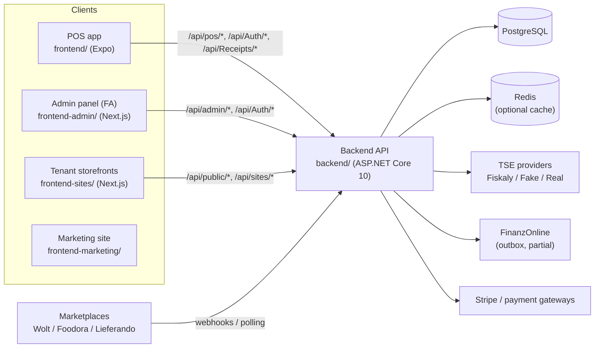

# 01 — Product and Architecture

> Part 1 of the Regkasse AI briefing. Index: [`../AI_PROJECT_BRIEFING.md`](../AI_PROJECT_BRIEFING.md).
> Verified at commit `e2be4d5b` (2026-11-24). Where code and docs disagree, this briefing follows the code and lists the conflict in [`08-risks-rules-and-gaps.md`](08-risks-rules-and-gaps.md).

## 1. Product summary

Regkasse is a production-oriented, multi-tenant POS system for Austria.

Core capabilities:

- POS sales and payments (cash, card, voucher, online payment) on a mobile/tablet POS app.
- RKSV fiscal compliance: TSE signing, a signature chain, sequential receipt numbers, RKSV special receipts (Nullbeleg, Startbeleg, Monatsbeleg, Jahresbeleg, Schlussbeleg), DEP §7 export, FinanzOnline outbox.
- Receipts, invoices, daily/monthly/yearly closing (Tagesabschluss), report PDFs.
- Vouchers (Gutschein) with a ledger.
- Offline resilience (two separate offline systems).
- Admin panel for reporting, RKSV operations, users/permissions, licenses, backups, TSE operations.
- SaaS platform features: tenants, trials, license sales, billing, tenant limits, self-service portal, support tickets.
- Non-fiscal digital services: tenant websites, PWA/native apps, online orders, marketplace intake (Wolt, Foodora, Lieferando).
- Multi-country shape: Austria is production. Germany, Switzerland, and an EU default are partly built and not production-ready (see [`03-domain-fiscal-payment.md`](03-domain-fiscal-payment.md) §9).

### Users

| Actor | Where they work |
|---|---|
| Cashier / Waiter / Kitchen | POS app (`frontend/`) |
| Manager ("Mandanten-Admin") | Admin panel, own tenant only |
| SuperAdmin | Admin panel, platform-wide (tenants, billing, backup, TSE ops) |
| Accountant / ReportViewer | Admin panel, read/report-focused |
| ComplianceOfficer | Platform compliance gate (production deployment sign-off), not POS |
| Tenant customers | Public storefront (`frontend-sites/`), online orders |

### Verticals (vertical profiles)

Vertical profiles are product configuration (POS features, required/optional fields, POS layout), not fiscal regimes. `docs/VERTICAL_PROFILES.md` lists these seed profiles: `gastronomy`, `gastronomy-tables`, `vet`, `hair-salon`, `mobile-services`, `handy-shop`, `taxi`, `ticket-sales`, `beherbergung` (lodging), `retail`. `docs/AI_CONTEXT.md` says "11 verticals". The count differs by one. Verify against `backend/Services/VerticalProfiles/` before relying on it. Layouts: `standard`, `tables`, `appointment`, `queue`, `taxi`, `ticket` (docs also reference a `rooms` layout for lodging).

## 2. System context

Real-time: SignalR hubs in `backend/Hubs/` (`KitchenHub`, `FiskalyOperationStatusHub`, `DemoImportProgressHub`). The POS uses `@microsoft/signalr` for the kitchen display; FA also lists `@microsoft/signalr`.

## 3. Environments and hosts

| Surface | Production | Development |
|---|---|---|
| POS UI | `https://pos.regkasse.at` (one shared UI for all tenants) | `http://localhost:8081` |
| FA UI | `https://admin.regkasse.at` | `http://admin.regkasse.local:3000` (hosts-file entry) |
| API | `https://api.regkasse.at` | `http://localhost:5184` |
| Sites | shared host, `/[slug]` or verified custom domain | `http://localhost:3001` |
| Marketing | (see `frontend-marketing/`) | `http://localhost:3002` |

Tenant identification (summary; full rules in [`04-tenancy-auth-security.md`](04-tenancy-auth-security.md)):

- **Production on shared hosts** (`pos`, `api`, `admin`, `www`): the tenant comes from the JWT `tenant_id` claim after login. Do not send `X-Tenant-Id` or `?tenant=`.
- **Development:** `X-Tenant-Id: <slug>` header first, then `?tenant=<slug>`, then Host slug, then a default of `dev`. The seeded demo tenant slug is **`dev`**. There is no business tenant with slug `default`.

## 4. Monorepo layout

| Path | What it is |
|---|---|
| `backend/` | ASP.NET Core API (`KasseAPI_Final.csproj`, test project `KasseAPI_Final.Tests/`, `swagger.json`, `Migrations/`). Also an npm workspace `@regkasse/backend` that wraps `dotnet` |
| `frontend/` | POS app. Package name `cash-register` |
| `frontend-admin/` | Admin panel. Package name `registrierkasse-admin` |
| `frontend-sites/` | Tenant storefronts. Package `regkasse-sites` |
| `frontend-marketing/` | Marketing site. Package `regkasse-marketing` |
| `localization/` | Shared i18n tooling (`@regkasse/localization`), CI budgets, namespace manifest |
| `scripts/` | OpenAPI verify, seeds, git hooks, smoke, load tests, ops, RKSV verification |
| `tools/` | License generator and i18n utilities |
| `testsprite/`, `testsprite_tests/` | API/E2E test definitions (TestSprite) |
| `monitoring/` | Monitoring configuration |
| `.github/workflows/` | CI/CD (about 30 workflows, inventory in `.github/workflows/README.md`) |
| `docs/` | About 166 Markdown docs (human documentation) |
| `ai/` | AI contracts and guardrails (`01..13_*.md`, `modules/*.md`, `training/`) |
| `.cursor/rules/` | Cursor rules (`000-core.mdc` is always applied) |

Root `package.json` workspaces: `backend`, `frontend`, `frontend-admin`, `frontend-sites`, `frontend-marketing`, `localization`.

Many build/scratch directories exist inside `backend/` (`_build_out*`, `tmp-*`, `.test-out*`, `bin`, `obj`, `publish`, ...). They are artifacts, not source. Ignore them when reading code.

## 5. Real technology stack (from `package.json` and `.csproj`)

| Layer | Stack |
|---|---|
| Backend | .NET 10 (`net10.0`), ASP.NET Core, EF Core **10.0.14**, Npgsql EF provider 10.0.3, ASP.NET Identity + JWT Bearer 10.0.14, Swashbuckle 10.3.1 |
| Backend libs | QuestPDF 2026.9.1 (PDF), SkiaSharp 3.119.4, QRCoder 1.8.1, Stripe.net 52.4.2, StackExchange.Redis + Redis cache, Sentry 5.16.3, prometheus-net 8.2.1, ElmahCore (PostgreSQL), BouncyCastle, Cronos, CsvHelper, ExcelDataReader |
| POS | Expo `^58.0.0`, React Native 0.88.1, React 19.3.0, expo-router ~58, Zustand 5, i18next 26 / react-i18next 17, axios, zod 4, jest 30 (jest-expo), Playwright, `expo-print`, `expo-secure-store`, `@sentry/react-native` |
| Admin (FA) | Next.js `^16.4.6`, React `^19.3.1`, Ant Design `^6.4.3`, TanStack Query 5, Orval 8 (generated client), Zustand 5 (UI prefs only), recharts, dayjs, vitest 4, Playwright, `@sentry/nextjs`, pino |
| Sites / Marketing | Next.js `^16.4.6`, React `^19.3.1`, TypeScript 5.9 (Marketing also uses vitest) |
| Database | PostgreSQL (16+ typical), EF Core migrations |
| Node | `>=20` (CI runs 22; `docs/AI_CONTEXT.md` says Node 22+) |

Some rule files still show older versions (Expo 56/57, Next 16.2.x). See the conflict table in part 08.

## 6. Satellite apps

### `frontend-sites/` (tenant storefronts)

- Next.js app with a single `src/` tree. Serves `/[slug]` storefronts: public catalog and online-order UI.
- Custom hosts are possible through verified `TenantDomain` rows (`ITenantDomainService`).
- Public backend endpoints: `/api/public/tenants/*`, `/api/public/sites/*`, `/api/sites/{slug}/status`, `/api/public/online-orders`, `/api/public/customer/*`.
- Non-fiscal. It must never be wired into the payment/RKSV chain.
- Scripts: `lint`, `typecheck`, and `test` are all `tsc --noEmit`. There are no unit tests.
- i18n for Sites is deferred in `localization/namespace-manifest.json`.

### `frontend-marketing/`

- Marketing site with SEO and de/en/tr. Has `src/`, `tests/`, `scripts/`, `public/`. Tests run with vitest.

## 7. Backend ↔ clients data flow (typical)

1. Client logs in at `POST /api/Auth/login` with `loginIdentifier` (email or username) plus `clientApp` (`pos` or `admin`).
2. The backend returns a JWT (with `tenant_id`, role, permissions-related claims) and a refresh token. Admin also uses HttpOnly cookies (see part 04).
3. Every request passes the middleware pipeline: tenant resolution → auth → tenant context → tenant validation → license / maintenance gates → payment/critical-action/operation-limit guards (full order in part 02).
4. Controllers call services. Services use `AppDbContext` with tenant query filters.
5. For POS sales, `PaymentService` runs the fiscal transaction (see part 03).
6. For Admin, the generated Orval client (React Query hooks) calls `/api/admin/*`.

## 8. Where to read more in the repo

| Need | File |
|---|---|
| One-page start | `docs/AI_CONTEXT.md` (most recent, 2026-11-24) |
| Older long brief | `REGKASSE_AI_ONBOARDING.md` (last reviewed 2026-07-21; some stack info is stale) |
| Rules index | `AGENTS.md`, `.cursor/rules/*.mdc` |
| Multi-tenant | `docs/MULTI_TENANT.md`, `docs/POS_PRODUCTION_ARCHITECTURE.md` |
| Fiscal | `ai/05_SECURITY_COMPLIANCE.md`, `ai/modules/tse_finanzonline.md`, `docs/RKSV_RUNTIME_CONFIG.md` |
| Countries | `docs/COUNTRIES.md` (§16 status) |
| Operations | `docs/PRODUCTION_DEPLOYMENT_RUNBOOK.md`, `docs/PRODUCTION_CUTOVER.md`, `docs/CI_CD.md` |
